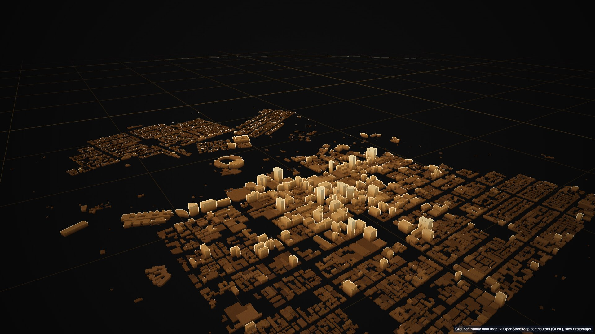
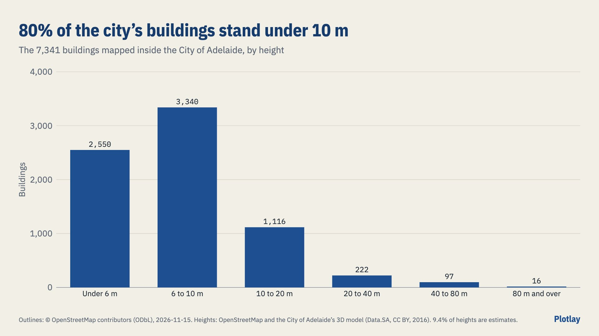

# Adelaide in Sepia

Every building mapped inside the City of Adelaide (the city centre, North Adelaide and the Park Lands round them), each with one height and where that height comes from. **Live version, with an interactive map and the 3D flight over the city:** [getplotlay.com/showcase/adelaide-in-sepia](https://www.getplotlay.com/showcase/adelaide-in-sepia/)



**7,341 buildings. 80% stand under 10 m; ten reach 100 m.** The tallest is The Adelaidean at 138 m (as mapped in OpenStreetMap). 179 buildings are 30 m or more, and 171 of them are south of the Torrens.

The model was made in [Plotlay](https://www.getplotlay.com): the buildings as data layers, raised in 3D at their heights and shown in the Sepia look. The charts, renders and the flight over the city were made in Plotlay too.

[](https://app.plotlay.io/?example=adelaide-in-sepia&as=client)

## Read this first

- **No construction years.** Unlike Melbourne, Adelaide has no open file of the year each building was built. Nothing here says when a building went up. SA Heritage Places (Data.SA) was checked: it lists 2,000 places in the council area with listing dates, not build dates, and only 94 mention a build year in prose.
- **About one height in ten is an estimate** (689 of 7,341, 9.4%). The table says which.

## Where each height comes from

No single open file gives every Adelaide building a current, measured height, so each building takes the best there is, in this order:

| Height from | Buildings | Share | How good |
|---|---|---|---|
| OpenStreetMap `height` tag | 51 | 0.7% | Mapped by hand, current. All ten buildings of 100 m or more. |
| City of Adelaide 3D model | 5,481 | 74.7% | Measured, as the building stood in the model (files of July 2016). |
| OpenStreetMap `building:levels` at 3 m each | 1,120 | 15.3% | Current but approximate. Runs low on towers. |
| Estimate by kind and size | 689 | 9.4% | A guess. None is over 20 m. |

The model gives way to OpenStreetMap's levels where the two clearly disagree: where levels at 3 m each are more than 6 m above the model (built or raised since), or where the model is more than 4.5 m a level plus 6 m (the outline is a low wing beside a tower). A mapped height comes first because the model is old. Of the 32 buildings with both a mapped height and a model height, 20 agree within 6 m (131.7 m against 132 m for RAA Place, 103.0 m against 103 m for Grenfell Centre). The largest gaps are towers built since the model was made: Realm Adelaide, mapped at 132 m, is a 10 m building in the model.



### Read it carefully

- **The council's model is about ten years old.** Its files are dated July 2016 and the survey behind them may be older. A building altered since, with nothing in OpenStreetMap to say so, keeps the model's height.
- **Levels at 3 m each run low on tall buildings.** 75 of the 179 buildings of 30 m or more take their height this way.
- **Not every building is mapped.** OpenStreetMap's outlines cover about 85% of the roof area in the state's 2022 building mask (within 1.5 m). The gaps are scattered and mostly small.
- **Flat tops.** Each building, or mapped building part, is one block at one height.
- OpenStreetMap as at 15 November 2026.

## How the model's heights were read

The council publishes its 3D model as SketchUp blocks (COLLADA inside four KMZ files). The scripts in [`method/`](method) turn every triangle into sample points, lay them over OpenStreetMap's outlines (the model sits on them within 2 m once turned by the 1.4 degree heading its files carry), and give each building the 90th percentile of the model's highest point in each 1 m cell of its outline, less the lowest model surface within 8 m. They need the council's files, which are not copied here (about 40 MB; the link is below).

## What's here

| Folder | What |
|---|---|
| [`data/`](data) | `buildings.csv`: one row a building, with `height_m`, `height_from`, and the columns the choice was made from (`osm_height_m`, `levels`, `model_height_m`). `buildings.geojson`: the outlines as drawn in 3D, one a building or mapped part, with `height_m` and `base_m` |
| [`python/`](python) | A short notebook that gets the numbers again: [`adelaide_in_sepia.ipynb`](python/adelaide_in_sepia.ipynb) |
| [`method/`](method) | The scripts that read the council's model and joined it to the outlines, and the two checks (coverage, heritage dates) |
| [`visuals/`](visuals) | The renders, charts and the flight over the city |

### Run the notebook

```
python3 -m venv .venv
.venv/bin/pip install -r python/requirements.txt
cd python && ../.venv/bin/jupyter lab adelaide_in_sepia.ipynb
```

## Sources and licences

- Building outlines, names, heights and levels: © OpenStreetMap contributors, [Open Database Licence](https://www.openstreetmap.org/copyright). Fetched with the Overpass API on 15 November 2026.
- Heights for 5,481 buildings: [3D Model of the City of Adelaide](https://data.sa.gov.au/data/dataset/3d-model), City of Adelaide, Data.SA, Creative Commons Attribution.
- Council boundary and suburbs: Australian Bureau of Statistics, ASGS Edition 3, CC BY 4.0.
- Coverage check: [Metropolitan Adelaide tree canopy, green spaces and built environment 2022](https://data.sa.gov.au/data/dataset/metropolitan-adelaide-tree-canopy-green-spaces-and-built-environment-2022) (building footprints), Department for Environment and Water, Data.SA, CC BY.
- Heritage check: [SA Heritage Places](https://data.sa.gov.au/data/dataset/sa-heritage-places), Department for Housing and Urban Development, Data.SA, CC BY.

The data in `data/` is made from OpenStreetMap and is licensed under the Open Database Licence 1.0 (`LICENSE-DATA`): if you publish a database made from it, offer it under the same licence. The pictures in `visuals/` are produced works under CC BY 4.0, crediting OpenStreetMap. The code is MIT (`LICENSE`). See `NOTICE`.

This is independent work using open data, not endorsed by the City of Adelaide or the South Australian Government.
